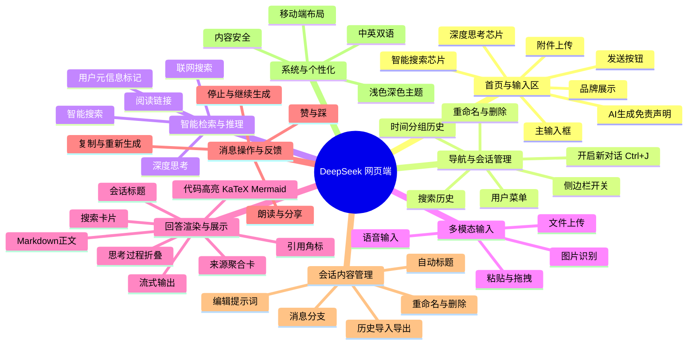

# DeepSeek 网页端产品分析报告

> 分析日期：2026-11-23
> 分析视角：资深产品经理
> 数据来源：chat.deepseek.com 登录态实测（ego-browser）、DeepSeek API 官方文档、官方开源演示客户端 chat-demo

---

## 一、产品定位

DeepSeek 网页端是深度求索面向 C 端用户的**免费通用 AI 对话助手**，定位"探索未至之境"。核心价值是用自然语言完成知识问答、写作、学习辅导、编程、长文档阅读与实时信息检索。

**产品哲学**：极简。首页只有输入框与两个模式开关，所有复杂性隐藏在对话过程中。

---

## 二、网页功能详细清单

### 模块 1：首页与输入区

| 功能点 | 说明 |
|--------|------|
| 品牌展示 | 左上角鲸鱼 Logo；首页居中显示"你好，让我们开始聊天吧" |
| 主输入框 | 底部居中大输入框，占位文案"给 DeepSeek 发送消息" |
| 深度思考芯片 | 开启后模型展示多步推理过程，适合数学/逻辑/编程 |
| 智能搜索芯片 | 开启后联网检索实时信息并附引用来源 |
| 附件按钮 | 支持 PDF/Word/PPT/图片上传 |
| 发送按钮 | 蓝色圆形上箭头，输入后点亮 |
| 免责声明 | "内容由 AI 生成，请仔细甄别" |

### 模块 2：导航与会话管理

| 功能点 | 说明 |
|--------|------|
| 侧边栏开关 | 展开/收起左侧会话栏 |
| 搜索历史 | 按标题搜索历史对话 |
| 开启新对话 | 快捷键 Ctrl+J |
| 历史分组 | 按"今天/7天内/30天内/月份"分组 |
| 历史项操作 | 悬停出现重命名、删除 |
| 用户菜单 | 深色模式、设置、退出登录 |

### 模块 3：智能检索与推理

| 功能点 | 说明 |
|--------|------|
| 深度思考 | 展示可折叠的"已思考（用时 X 秒）"面板 |
| 智能搜索 | 展示"浏览 N 个页面"卡片，正文含引用角标 |
| 联网搜索 | 通过 deepseek_web_search 工具实现 |
| 阅读链接 | 通过 deepseek_read_url 工具实现 |
| 用户元信息标记 | 日期/地区/语言随请求发送 |

### 模块 4：多模态输入

| 功能点 | 说明 |
|--------|------|
| 文件上传 | PDF、Word、PPT、图片等 |
| 图片识别 | 识别图中文字、理解图片内容 |
| 语音输入 | ASR 语音转文字 |
| 粘贴/拖拽 | 演示客户端支持 |

### 模块 5：回答渲染与展示

| 功能点 | 说明 |
|--------|------|
| 会话标题 | 顶部居中显示当前会话标题 |
| 思考面板 | 浅灰底可折叠推理过程 |
| 搜索卡片 | "浏览 N 个页面" |
| 引用角标 | [1][2] 等蓝色角标，点击跳来源 |
| Markdown 正文 | 标题/列表/链接/代码块 |
| 富内容 | 代码高亮、KaTeX 公式、Mermaid 图表 |
| 来源聚合卡 | "20 个网页"聚合 |
| 流式输出 | 逐字呈现 |

### 模块 6：消息操作与反馈

| 功能点 | 说明 |
|--------|------|
| 复制 / 重新生成 | 一键复制、重新发起生成 |
| 赞 / 踩 | 正负反馈 |
| 朗读 | TTS 语音播放 |
| 分享 | 分享回答或会话 |
| 停止 / 继续生成 | 生成过程控制 |

### 模块 7：会话内容管理

| 功能点 | 说明 |
|--------|------|
| 自动生成标题 | 回答结束生成简短标题 |
| 重命名 / 删除 | 手动管理 |
| 编辑提示词 | 编辑已发消息后重新提问 |
| 消息分支 | 同一消息处切换不同回复 |
| 历史导入导出 | ZIP 格式 |

### 模块 8：系统与个性化

| 功能点 | 说明 |
|--------|------|
| 浅色/深色主题 | 双主题 |
| 中英双语 | 界面语言 |
| 移动端布局 | 响应式适配 |
| 内容安全 | safety_check 风控 |

---

## 三、产品功能结构图

### 3.1 Mermaid 思维导图



### 3.2 层级结构图

```
DeepSeek 网页端
├─ 首页与输入区
│  ├─ 鲸鱼Logo + 居中标语
│  ├─ 主输入框 + 双模式芯片
│  └─ 附件/发送 + 免责声明
├─ 导航与会话管理
│  ├─ 侧边栏开关/搜索/新对话(Ctrl+J)
│  ├─ 时间分组历史 + 重命名/删除
│  └─ 用户头像菜单
├─ 智能检索与推理
│  ├─ 深度思考（可折叠思考链）
│  ├─ 智能搜索（联网+引用）
│  └─ 用户元信息标记
├─ 多模态输入
│  ├─ 文件上传（PDF/Word/PPT/图片）
│  └─ 语音输入/粘贴拖拽
├─ 回答渲染与展示
│  ├─ 思考面板/搜索卡片
│  ├─ 引用角标/来源聚合卡
│  └─ Markdown + 流式输出
├─ 消息操作与反馈
│  ├─ 复制/重新生成/赞踩
│  └─ 朗读/分享/停止生成
├─ 会话内容管理
│  └─ 自动标题/重命名/删除/分支/导入导出
└─ 系统与个性化
   └─ 主题/双语/移动端/内容安全
```

---

## 四、核心交互流程

```
打开 chat.deepseek.com
  → [未登录] 登录页 → [已登录] 首页
  → 选择模式（深度思考/智能搜索）+ 输入消息
  → 点击发送 → 流式生成
      ├─ 深度思考 → "已思考（用时X秒）"面板
      └─ 智能搜索 → "浏览N个页面"卡片
  → 正文流式呈现（Markdown + 引用角标）
  → 完成 → 自动生成标题 → 侧边栏新增历史项
  → 用户操作：复制/重新生成/赞踩/朗读/分享
```

---

## 五、UI 视觉规范（实测提取）

| 项目 | 规格 |
|------|------|
| 主色 | DeepSeek 蓝 `#4D6BFE` |
| 背景 | 纯白 `#FFFFFF` |
| 侧边栏 | 宽约 320px，白底，1px 浅灰分割线 |
| 输入框 | 圆角约 18px，浅灰边框，宽约 760px 居中 |
| 模式芯片 | 胶囊形，选中蓝底浅蓝字 |
| 字体 | 系统无衬线（PingFang SC / Microsoft YaHei） |
| 思考面板 | 浅灰底圆角块，折叠箭头 |
| 免责声明 | 12px 灰字，输入框下方居中 |

---

## 六、优化方向（为增强层提供设计依据）

| 维度 | 原版现状 | 优化机会 |
|------|---------|---------|
| 会话组织 | 扁平时间分组 | 标签/收藏、置顶、搜索过滤 |
| 单任务深度 | 单窗口线性对话 | 多面板工作区、分支对比 |
| 提示词 | 用户自行输入 | 提示词库、快捷指令 |
| 沉浸感 | 纯白极简 | 专注模式、自定义主题 |
| 上下文感知 | 依赖模型自动 | 上下文用量可视化 |
| 多模型 | 单一默认 | 模型选择器 |
| 知识沉淀 | 历史仅标题 | 收藏、笔记、导出 Markdown |
| 协作 | 单用户 | 会话分享、团队空间 |

增强层的实际落地见 `02_优化版设计说明.md`。
